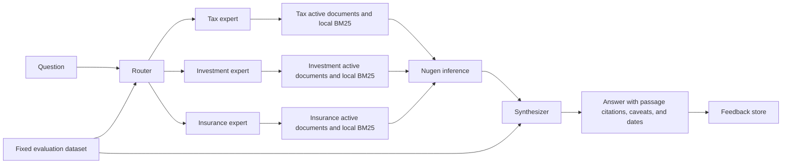

# FinPilot AI

FinPilot AI is an educational finance assistant for Indian tax, investment, and insurance questions. A router selects one or more domain experts. Each expert retrieves passages only from its explicitly active, provider-READY document set, asks a Nugen model to answer from those passages, and returns evidence and limitations. A synthesizer combines multiple expert results while retaining disagreements and source gaps. The application is not a licensed financial adviser.

## Architecture



The three expert retrieval paths are domain-filtered and use the local BM25 implementation in `backend/app/evidence_retrieval.py`. There is no vector database or configured embedding search. An answer is described as source-grounded only when retrieved passages were supplied and its citation markers map to those passages. Claim verification is a separate status: exact sentence comparison is not semantic entailment, and an independent verifier is available only if separately configured and checked.

## Repository map

- `backend/app/`: FastAPI routes, typed schemas, routing, retrieval, inference, synthesis, feedback, alignment tracking, and source-content storage.
- `backend/app/nugen/`: provider-specific Nugen client, schemas, safe errors, and document/alignment service methods.
- `backend/tests/`: local tests. Provider calls use mocked HTTP transports; no test submits an alignment or deployment job.
- `frontend/`: React and TypeScript chat UI. In production, the compiled app is served by FastAPI from the same origin as the API.
- `knowledge_bases/*_expert.txt`: source-labeled educational corpora for the three domains.
- `knowledge_bases/prepared/`: reviewed source drafts; they are scanned but are not selected for inference unless registered and activated.
- `knowledge_bases/source_documents/`: ignored local retrieval bytes, named by a hash of each Nugen document ID. Never commit this directory.
- `eval/`: fixed router and evaluation cases. Generated `eval/results_*.json` are ignored.
- `scripts/`: corpus checking, seeding, manual corpus registration, alignment reporting, smoke checks, and evaluation.
- `Dockerfile` and `render.yaml`: one-service deployment configuration. Auto-deploy is disabled in the blueprint.

## Windows PowerShell setup

Run these commands from the repository root:

```powershell
Set-Location C:\Users\rohit\finpilot-ai
py -3.12 -m venv .venv
.\.venv\Scripts\Activate.ps1
python -m pip install --upgrade pip
python -m pip install -r backend\requirements.txt
```

Install and build the web client in a second PowerShell window:

```powershell
Set-Location C:\Users\rohit\finpilot-ai\frontend
npm ci
npm run lint
npm test
npm run build
```

For local development, start the API in one window:

```powershell
Set-Location C:\Users\rohit\finpilot-ai
.\.venv\Scripts\python.exe -m uvicorn backend.app.main:app --reload --host 127.0.0.1 --port 8000
```

Start Vite in another window:

```powershell
Set-Location C:\Users\rohit\finpilot-ai\frontend
npm run dev
```

The Vite development server proxies `/api` and `/health` to the API. The production app and API use the same origin; CORS grants no external origins. `/health` is the liveness endpoint and does not call Nugen or MongoDB.

## Configuration

Copy `.env.example` to a local `.env` and configure values on your own machine. `.env` is ignored by Git. This README intentionally lists variable names only and contains no configured values:

- `NUGEN_API_KEY`
- `NUGEN_API_BASE_URL`
- `NUGEN_TEST_MODEL_ID`
- `NUGEN_TAX_MODEL_ID`
- `NUGEN_INVESTMENT_MODEL_ID`
- `NUGEN_INSURANCE_MODEL_ID`
- `MONGODB_URI`
- `MONGODB_DATABASE`
- `FINPILOT_CORRECTION_REVIEW_TOKEN`
- `SEED_CONTENT_ON_STARTUP`

The Nugen key is server-side only. Do not put it in Vite settings or browser code. Model IDs are configuration, not proof of domain alignment. Alignment is provider-confirmed only after the tracked job, resulting aligned-model row, and deployment status are checked.

## Request and evidence flow

`POST /api/ask` accepts a question and an optional list of expert overrides. Without an override, `backend/app/router.py` first tries the configured router model, then falls back to keyword routing if model routing is unavailable or invalid. A question outside the three domains can produce an empty route and no expert call.

For each selected expert, `backend/app/inference_api.py` checks the Mongo active-source selection, checks each selected document's current Nugen status, and requires `READY`. It loads the corresponding local bytes and refuses missing, invalid UTF-8, or byte-count-mismatched content. Retrieval ranks passages with BM25 and assigns citation IDs. Only the selected domain's passages enter that expert's prompt. No generic model knowledge is added as evidence.

Nugen inference is made through the typed client in `backend/app/nugen/client.py`. The expert output is checked against retrieved citation IDs. Multiple expert answers go through `backend/app/synthesizer.py`; the synthesizer is instructed to preserve disagreements and not introduce external facts. If synthesis citations fail validation, the draft is withheld.

`source_grounding_supported` means that retrieved passages were used and answer citations passed the source mapping checks; it does not mean that factual claims were independently proven. Claim assessments are returned per claim. Exact source-text matches can be labeled as such, while paraphrases stay unverified without a suitable verifier. A configured verifier must be a distinct inference-ready model and its output must pass schema and quote checks. The current default is verification unavailable.

The UI renders Markdown with HTML disabled, validates external links, maps `[S1]` citations to evidence cards, displays the source URL and retrieval date, and labels unverified model status as `Base model (not aligned)`. HTTP 429, request timeout, unavailable source content, and generic service errors are shown separately.

## Source document workflow

The existing API routes are available in Swagger at `http://127.0.0.1:8000/docs`:

- `GET /api/nugen/base-models` lists supported base models.
- `POST /api/documents` uploads one UTF-8 text source to Nugen and saves local provenance and source bytes. It creates a new Nugen document; it does not replace an existing document in place.
- `GET /api/documents?domain=tax|investment|insurance` lists locally registered documents.
- `GET /api/documents/{domain}/{document_id}/status` refreshes document status from Nugen.
- `GET /api/documents/{domain}/active-source` reads the explicit active set.
- `PUT /api/documents/{domain}/active-source` validates provider readiness and local content before atomically selecting an exact document set.
- `POST /api/documents/{domain}/active-source/rollback` revalidates and restores the previously selected set.

The active selection is separate from document registration. Uploading a document does not activate it. Active-source changes preserve one previous selection for rollback. Do not activate every READY document by default.

`scripts/register_corpus.py` is a manual cutover helper. Its default is a local dry run that validates the source files and prints the plan without making API requests:

```powershell
Set-Location C:\Users\rohit\finpilot-ai
.\.venv\Scripts\python.exe scripts\register_corpus.py
.\.venv\Scripts\python.exe scripts\register_corpus.py --domain tax
```

Only after reviewing the plan and confirming the intended uploads and active-source changes, run the confirmed form. This performs document uploads through the local API, polls status until Nugen confirms `READY`, then activates only the new document ID for that domain. The route preserves the previous active selection for rollback. It never starts an alignment or deployment job.

```powershell
.\.venv\Scripts\python.exe scripts\register_corpus.py --domain tax --confirm
```

Run one domain at a time and inspect the response and active-source status before proceeding to another. Do not rerun a confirmed upload blindly after an uncertain response; check the registered document list first.

Local source bytes can be restored from the committed expert corpus only when a registered document is `READY` and its stored byte count matches exactly. The seeder never overwrites a file or calls Nugen. Leave `SEED_CONTENT_ON_STARTUP` disabled unless the current Mongo records and local corpus byte counts have been checked. An empty or new Mongo database does not contain document records or active selections; those must be migrated or registered and explicitly activated.

## Alignment and deployment workflow

Alignment is separate from ordinary inference and may consume provider resources. Previewing an alignment is not a submission. The explicit workflow is:

1. `POST /api/alignments/prepare` validates the base model and registered READY documents and returns the exact request preview. It does not submit a job.
2. A human reviews domain, source document IDs, base model ID, and payload.
3. Only with explicit confirmation, call `POST /api/alignments/submit` with `confirm_submission: true`.
4. Poll `GET /api/alignments/{alignment_id}/status`. FinPilot checks the provider status and linked aligned-model result.
5. Deployment is a separate explicit request to `POST /api/alignments/{alignment_id}/deploy` with `confirm_deployment: true`.
6. Treat a model as aligned and inference-ready only after Nugen confirms completed alignment, matching model identity, and deployed status.

`scripts/alignment_report.py` refreshes the latest tracked job for each domain from Nugen and updates local status records. It is read-only with respect to provider jobs: it does not submit alignments or deploy. Use `--no-refresh` to inspect Mongo tracking only. Neither command has been run as part of this change, so this README makes no new claim about any domain's current alignment status.

## Feedback and verified corrections

`POST /api/feedback` stores user ratings separately from the question record. A user saying an answer is wrong is not accepted as ground truth. `POST /api/verified-corrections` requires reviewer authorization and source references, and stores reviewer-attested corrections separately. Feedback does not silently rewrite the knowledge base, train a model, or change a Nugen alignment.

## Evaluation and manual smoke checks

The fixed cases are in `eval/questions.json`; `scripts/run_eval.py` reports routing accuracy and, in full mode, answer coverage, grounding rate, and latency. Its routing-only mode skips expert inference, direct baseline answers, and retrieval, but may still call the configured Nugen router model and writes a local ignored JSON result. Run only when that API use is intended:

```powershell
Set-Location C:\Users\rohit\finpilot-ai
.\.venv\Scripts\python.exe scripts\run_eval.py --routing-only
```

Full evaluation additionally makes baseline inference and `/api/ask` calls; it requires the separate `--confirm-full-eval` flag. Tests do not call this script or Nugen.

With the API and source sets ready, the manual smoke test checks `/health`, one example per domain, an ELSS/NPS cross-domain question, and an out-of-scope question. It sends requests to the local API; `/api/ask` can use the configured router and Nugen experts and records the query in MongoDB.

```powershell
.\.venv\Scripts\python.exe scripts\smoke_test.py
```

Check corpus provenance, length, and prompt-instruction leakage locally:

```powershell
.\.venv\Scripts\python.exe scripts\check_corpus.py
```

## Tests and quality checks

From the repository root:

```powershell
.\.venv\Scripts\python.exe -m pytest -q
Set-Location frontend
npm run lint
npm test
npm run build
Set-Location ..
git diff --check
```

Backend tests use fakes and mocked HTTP responses. They do not require API credits, a live MongoDB service, document uploads, alignment submission, deployment, or live inference.

## Render and MongoDB Atlas deployment

`Dockerfile` builds the React app and runs the FastAPI server in one container. It binds to the `PORT` environment variable and checks `/health`. `render.yaml` defines one Docker web service, uses `/health` as its health check, disables automatic deployment, and marks each environment variable `sync: false`; no secret values are stored in the blueprint.

Manual deployment outline:

1. Create a MongoDB Atlas database and a least-privilege application user. Configure network access for the Render service using a documented secure access method.
2. Decide how to migrate or re-register the source-document records, local bytes, active-source selections, interaction records, and alignment tracking. A new database does not inherit existing Atlas state automatically.
3. Connect the GitHub repository to Render and review the Blueprint before creating the service. Confirm that the deployment is manual and that the Docker health check is `/health`.
4. Enter the required values for the names listed under Configuration in the Render dashboard. Never commit a populated `.env` or place credentials in frontend settings.
5. Verify `/health`, document readiness, local source-content availability, and active-source selections. Then use the manual alignment report to check provider status if needed.
6. Deploy only after reviewing logs and the exact resource changes. No service has been deployed from this repository change.

See the [Render Blueprint specification](https://render.com/docs/blueprint-spec) and [MongoDB Atlas documentation](https://www.mongodb.com/docs/atlas/) for current platform setup details.

## Evaluation result placeholders

No benchmark was run for this README update. Replace these placeholders only with measured results from the same fixed dataset and mode.

| Evaluation mode | Cases | Routing accuracy | Grounded answers | Latency | Status |
|---|---:|---:|---:|---:|---|
| Router-only | Not measured | Not measured | Not applicable | Not measured | Placeholder — not run |
| Full baseline and system | Not measured | Not measured | Not measured | Not measured | Placeholder — not run |

## Limitations and next steps

- No expert alignment status is asserted here; provider status was not freshly checked in this work.
- Retrieval is local BM25 over the active domain corpus. There is no vector or embedding search.
- Claim verification is unavailable unless a distinct verifier is configured and its responses pass validation. Exact-text matches do not establish semantic entailment.
- The corpus is educational, source-labeled, and dated. Official pages can change; time-sensitive tax and insurance rules require a current source check.
- Source-grounded output can still be incomplete or wrong. A citation is evidence provenance, not a correctness guarantee.
- A fresh database needs existing records and active selections migrated or new documents registered and activated; seeding only restores matching local text bytes.

**What I would do next:** review the corpus sources and status output; confirm the MongoDB data migration plan; perform one domain's document registration and activation manually; verify the rollback path; then decide whether to submit a separately reviewed alignment job. Only after those checks would I deploy and run the manual smoke and fixed-dataset evaluations.
