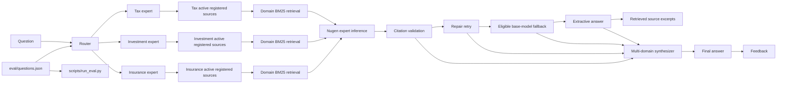

# FinPilot AI

A finance education assistant for Indian tax, investing, and insurance, built for the Nugen Intelligence challenge.

## Live demo

- Frontend (Firebase Hosting): [finpilot-ai-nugen.web.app](https://finpilot-ai-nugen.web.app)
- Backend and full app (Render): [finpilot-ai-t691.onrender.com](https://finpilot-ai-t691.onrender.com)
- Health: [`/health`](https://finpilot-ai-t691.onrender.com/health)
- Source health: [`/api/source-health`](https://finpilot-ai-t691.onrender.com/api/source-health)
- GitHub: [Rohithreddy64004/finpilot-ai](https://github.com/Rohithreddy64004/finpilot-ai)

The demo URLs are provided for review; their availability was not checked during this README update.

## How it works



Each selected expert retrieves only from that domain's active, registered documents using the local BM25 implementation in `backend/app/evidence_retrieval.py`. The backend checks provider readiness and matching local source content before retrieval. Citation validation checks that answer markers refer to retrieved passages.

When an aligned model's wording fails citation validation, the system retries with stricter citation instructions, then can use a labeled base-model fallback, followed by an extractive answer or source excerpts. The answer card shows the model mode; its Details section shows the model ID. Multi-domain results are synthesized into one answer. Feedback is stored separately from source content and does not train or align a model.

## Aligned models

The project owner supplied the following report, produced by `scripts/alignment_report.py` against the provider and cross-checked with the provider's aligned-models list on **2026-10-23**:

| domain | alignment_id | alignment_status | verification | model_id | deployment | inference_ready |
|---|---|---|---|---|---|---|
| tax | alignment_01m4zn5m7jg27j21 | aligned | VERIFIED | model_01m4zn7v8md7m8mx | DEPLOYED | True |
| investment | alignment_01m4zzsn877xc87j | aligned | VERIFIED | model_01m4zzw135k1vn9p | DEPLOYED | True |
| insurance | alignment_01m5015thh3cjcvz | aligned | VERIFIED | model_01m50184vfepwh85 | DEPLOYED | True |

The provider's aligned-models list identifies the models as `model_finpilot_tax_expert`, `model_finpilot_investment_education`, and `model_finpilot_insurance_education`. The list reports all three as `DEPLOYED` on `meta-llama/Llama-3.2-3B-Instruct`, created on 2026-10-15. These experts were aligned on the initial corpus version; inference retrieval uses the currently active registered corpus and matching local content.

## Trust and safety design

- Citation validation rejects unknown or malformed source markers and withholds unsupported generated wording.
- The UI shows an aligned badge only when the backend reports provider-confirmed alignment; otherwise it labels the answer as a base model.
- Out-of-scope questions return the router's out-of-scope reason without calling a domain expert.
- A citation shows where wording came from; it does not prove that a claim is correct. Per-claim checks are not an independent semantic verifier by default.
- Educational information only. Not personalized or licensed financial advice.
- Keep secret values out of source control. This README lists configuration names only.

## Tech stack

FastAPI, React, Vite, TypeScript, MongoDB Atlas, Nugen API, Render, and Firebase Hosting.

## Quick start

In Windows PowerShell, from the repository root:

```powershell
py -3.12 -m venv .venv
.\.venv\Scripts\python.exe -m pip install -r backend\requirements.txt
Set-Location frontend
npm ci
Set-Location ..
```

Configure the required values in your local environment. The application settings read these backend variable names:

`APP_NAME`, `APP_ENV`, `FRONTEND_ORIGINS`, `MONGODB_URI`, `MONGODB_DATABASE`, `MONGODB_TIMEOUT_MS`, `SOURCE_CONTENT_DIRECTORY`, `SEED_CONTENT_ON_STARTUP`, `API_RATE_LIMIT_REQUESTS`, `API_RATE_LIMIT_WINDOW_SECONDS`, `NUGEN_API_KEY`, `NUGEN_API_BASE_URL`, `NUGEN_TIMEOUT_SECONDS`, `NUGEN_GET_RETRIES`, `ASK_EXPERT_TIMEOUT_SECONDS`, `NUGEN_TEST_MODEL_ID`, `NUGEN_TAX_MODEL_ID`, `NUGEN_INVESTMENT_MODEL_ID`, `NUGEN_INSURANCE_MODEL_ID`, `NUGEN_CLAIM_VERIFIER_MODEL_ID`, and `FINPILOT_CORRECTION_REVIEW_TOKEN`.

The frontend also reads `VITE_API_BASE_URL` at build time. Render supplies `PORT`. Keep the Nugen key, MongoDB URI, and correction-review token on the backend only; do not place secrets in Vite settings.

Run the API and frontend in separate PowerShell windows:

```powershell
# Repository root
.\.venv\Scripts\python.exe -m uvicorn backend.app.main:app --reload --host 127.0.0.1 --port 8000
```

```powershell
# frontend/
npm run dev
```

Vite proxies API requests to the local backend. The API routes include `POST /api/ask`, `POST /api/feedback`, and `GET /api/source-health`.

Run tests and frontend checks:

```powershell
# Repository root
.\.venv\Scripts\python.exe -m pytest -q
Set-Location frontend
npm run lint
npm test
npm run build
```

## Deployment

The repository supports two deployment shapes:

1. **Single Render service.** The Docker build compiles the React frontend and the FastAPI app serves it from the same origin. `render.yaml` selects the Docker runtime, health check, and manual deployment behavior.
2. **Firebase frontend and Render backend.** Firebase Hosting serves `frontend/dist`; Render serves the API. Set `VITE_API_BASE_URL` at frontend build time and configure `FRONTEND_ORIGINS` in Render for the Firebase Hosting origins.

For either option, configure MongoDB Atlas network access for the Render service using the access policy appropriate to your deployment. Set backend environment values in Render, not in the repository. `SEED_CONTENT_ON_STARTUP` enables startup seeding only for registered READY documents whose expected local bytes match.

Recommended manual order:

1. Review corpus sources. Run `scripts/register_corpus.py` as a dry run, inspect its plan, then confirm each intended domain registration and active-source change.
2. After records are registered and READY, run `.\.venv\Scripts\python.exe scripts\seed_content.py` to restore missing local retrieval content from matching records.
3. Manually deploy the Render service. Auto-deploy is off; startup seeding runs when enabled.
4. Check `/health` and `/api/source-health`, then run `scripts/smoke_test.py --base-url https://finpilot-ai-t691.onrender.com`.
5. Run `.\.venv\Scripts\python.exe scripts\alignment_report.py` to refresh and review tracked provider status. This does not submit an alignment job or deploy a model.

For Firebase Hosting, build from `frontend/` with `VITE_API_BASE_URL` set to the Render backend URL, then deploy the Hosting target configured in `frontend/firebase.json` and `frontend/.firebaserc`. The Firebase CLI command is:

```powershell
firebase deploy --only hosting --project finpilot-ai-nugen
```

## Tests

Results from **2026-10-23**:

| Suite | Result |
|---|---|
| Backend: `.\.venv\Scripts\python.exe -m pytest -q` | 260 passed, 4 skipped |
| Frontend: `npm test` | 3 test files passed, 45 tests passed |

The four skipped cases are two 80C retrieval cases, one NPS retrieval case, and one PPF retrieval case. Their skip reason is: “NPS/80C/PPF sections not in the registered corpus; re-enable after verified sources are registered”. The evaluation-data corpus-term check passes after restoring the `cross-04` unsupported-term annotation. The frontend suite passed on one retry after the restricted run could not spawn a Vite child process.

## Evaluation

`eval/questions.json` contains the fixed evaluation cases. `scripts/run_eval.py --routing-only` measures routing without expert inference, but can still call the configured Nugen router and writes an ignored result file. No evaluation result file was present under `eval/` when checked for this update, so evaluation results have not been published here.

## Known limitations

- NPS, 80C, and PPF coverage is pending verified sources. The four corresponding retrieval cases are skipped until those sources are registered.
- Per-claim output is not independently verified unless a distinct verifier is configured and successfully used; exact text comparison is not semantic entailment.
- Citation validation can fall back to extractive text or source excerpts when generated wording fails validation.

## What I would do next

Verify and expand the corpus with current primary sources for 80C, NPS, and PPF; register a reviewed v2 corpus and consider aligning it only after provider and source checks; add a separately validated claim verifier; run and publish the fixed evaluation; and provide persistent storage for retrieved source content.

## Author

**Rohith Reddy** - [GitHub: Rohithreddy64004](https://github.com/Rohithreddy64004)
